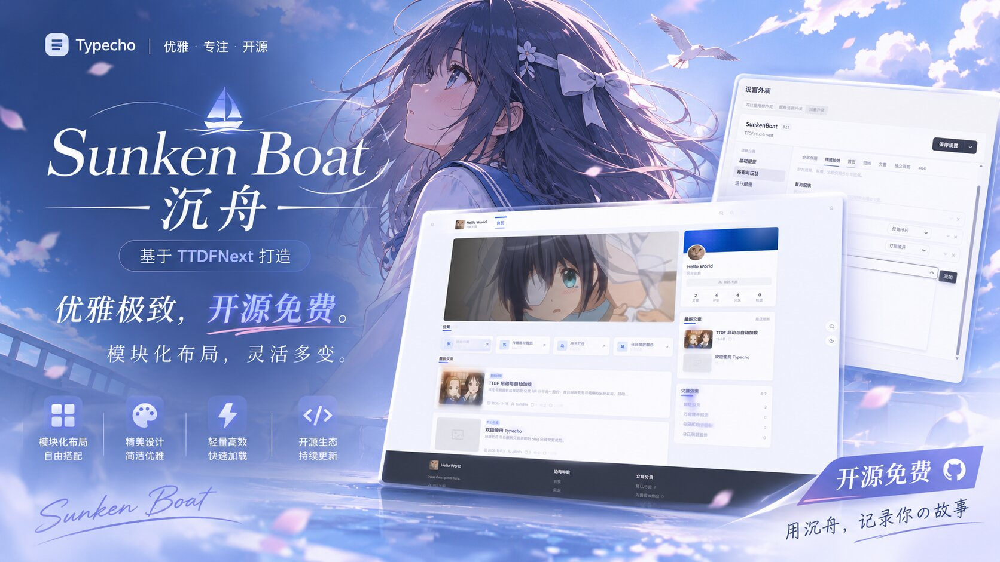

# SunkenBoat

SunkenBoat 是一套使用 TTDF Next 构建的 Typecho 主题。

运行环境：PHP 8.2+ / Typecho 1.2.1+ 或 1.3.x

## 功能

主题集成文章资讯、付费下载、社区论坛、用户系统、运营中心、文章组件等功能，采用模块化布局设计，像拼积木一样自由搭配组合。

## 开发

前端：

Vite + React + Shadcn/UI + TailwindCSS

安装依赖并启动 Vite：

```bash
pnpm --dir vite install
php vendor/yuinijika/ttdf/bin/ttdf dev --vite
pnpm --dir vite dev
```

生产构建与关闭开发模式：

```bash
pnpm --dir vite build
php vendor/yuinijika/ttdf/bin/ttdf dev --off
```

构建会写入 `assets/dist/`，PHP 通过 TTDF 的 `manifest` 读取带哈希的 JS 与 CSS，不需要修改模板。

## 前端挂载

PHP 只需输出挂载点：

```html
<div data-ttdf-component="ThemeToggle"></div>
```

`vite/src/main.tsx` 自动扫描 `[data-ttdf-component]`，从 `data-*` 读取 props，并把对应 React 岛挂载到该节点。未知组件在开发模式下只输出控制台警告，不会阻断页面。

## 文档

- 主题开发 Skill：<https://blog.miomoe.cn/docs/skill/typecho-theme-dev>
- TTDF v5 文档：<https://blog.miomoe.cn/docs/ttdf/v5/index>

线上文档是唯一真源，仓库内不维护完整文档副本。

## License

MIT
